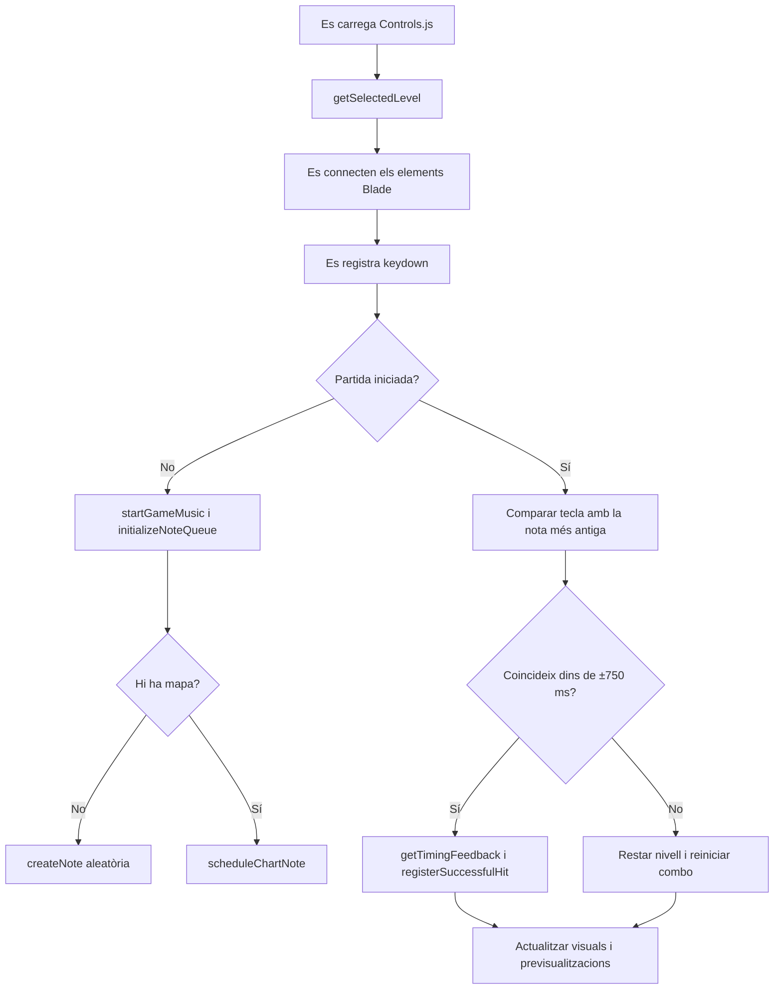

# Guia tècnica de GuitarherOso

Aquesta guia complementa [`GUIA_GuitarherOso.md`](./GUIA_GuitarherOso.md). Aquí seguim les dades i les crides entre funcions amb més detall, amb fragments reals de l’aplicació.

## 1. Referència ràpida

| Fitxer | Conté |
| --- | --- |
| [`Controls.js`](./Controls.js) | Estat de la partida, temporitzadors, teclat i coordinació entre els mòduls. |
| [`gameConfig.js`](./gameConfig.js) | Tecles, ritmes, imatges i constants. |
| [`noteElements.js`](./noteElements.js) | Selecció aleatòria, càlcul de trajecte, creació de notes i previsualitzacions. |
| [`noteTiming.js`](./noteTiming.js) | Finestra d’encert, classificació temporal i percentatge de precisió. |
| [`noteVisuals.js`](./noteVisuals.js) | Animació del combo i missatges visuals. |
| [`levelCharts.js`](./levelCharts.js) | Configuració i validació dels mapes. |

`Controls.js` és el punt d’entrada JavaScript. La vista [`GuitarherOso.blade.php`](../../../views/games/GuitarherOso.blade.php) la carrega amb `@vite`; els seus `import` carreguen automàticament la resta de mòduls.

## 2. Model mental: quines dades circulen

### Dades d’una nota musical

`gameConfig.js` associa una tecla a una nota i a un control HTML:

```js
a: { note: 'A', control: '1' },
s: { note: 'B', control: '2' },
```

La dada de nota és, per tant, un objecte com `{ note: 'A', control: '1' }`.

### Dades d’una figura rítmica

Cada ritme conté el nom, cinc imatges i el nombre de polsos:

```js
{
    name: 'negra',
    normalImage: negraNormalImage,
    redImage: negraRedImage,
    greenImage: negraGreenImage,
    yellowImage: negraYellowImage,
    blueImage: negraBlueImage,
    beats: 1
}
```

La imatge normal es mostra mentre la nota està activa. Després d’un encert, el joc substitueix la imatge per una de color segons la precisió. En mode aleatori, `beats` també determina l’interval fins a la nota següent.

### Element HTML que representa una nota activa

`createNoteImage()` crea un `` i desa informació a `dataset`:

```js
noteImage.dataset.key = note.note;
noteImage.dataset.createdAt = createdAt;
noteImage.dataset.hitTime = hitTime;
```

`dataset` guarda text. Per això, quan el codi fa operacions numèriques, converteix aquests valors amb `Number(...)`.

`activeNotes` és un `Set` d’aquests elements ``. Com que un `Set` conserva l’ordre en què s’hi afegeixen elements, la primera nota del conjunt és la més antiga i és la que s’ha d’encertar primer.

### Dades d’una nota d’un mapa

Un element de `levelCharts.js` com aquest:

```js
{ atMs: 3000, note: 'A', rhythm: 'negra' }
```

significa “encerta la nota A al cap de 3000 ms”. `getSelectedLevel()` transforma `note` i `rhythm` en els objectes complets de `gameConfig.js`. `scheduleChartNote()` crea la imatge abans del moment d’encert, perquè la nota necessita travessar el pentagrama.

## 3. Recorregut de l’execució



### Exemple numèric del moment d’encert

La durada total del moviment és `2500 ms`, però la nota arriba a la línia abans que acabi tot el moviment. Per exemple, si el pentagrama fa `800 px` d’amplada:

```text
posició inicial = 800 - 70 = 730 px
posició final   = -35 px
posició d’encert = (800 × 0,075) - 35 = 25 px
temps d’encert ≈ 2500 × (730 - 25) / (730 - (-35)) ≈ 2304 ms
```

Per una nota de mapa amb `atMs: 3000`, `scheduleChartNote()` la programa aproximadament `3000 - 2304 = 696 ms` després de començar el rellotge. La nota tarda uns `2304 ms` més a arribar a la línia.

## 4. `gameConfig.js`: constants i taules de dades

Aquest fitxer no declara funcions. Exporta dades que importen `Controls.js`, `noteElements.js`, `noteTiming.js` i `levelCharts.js`.

### `notesByKey` i `noteTypes`

`notesByKey` és un objecte indexat per la tecla en minúscula. El gestor de teclat consulta `notesByKey[event.key.toLowerCase()]`. `noteTypes` és `Object.values(notesByKey)`: una llista que facilita l’elecció aleatòria i la validació dels mapes.

### Constants de temps i joc

| Constant | Valor | On s’aplica |
| --- | ---: | --- |
| `quarterNoteDuration` | `500 ms` | Pols base; es publica com `--quarter-note-duration`. |
| `gameSpeed` | `1` | Divisor de l’interval aleatori. |
| `noteTravelDuration` | `2500 ms` | Durada del moviment CSS i límit inferior orientatiu dels mapes. |
| `noteHitWindowMs` | `750 ms` | Finestra d’encert abans/després del temps ideal. |
| `perfectWindowMs` | `150 ms` | Límit de classificació “Perfecto”. |
| `pixelPerfectWindowMs` | `30 ms` | Límit de “SUPER PERFECT”. |
| `ghostNoteCount` | `3` | Màxim de previsualitzacions simultànies. |
| `levelStep` | `5` | Punts afegits o restats al nivell. |

El CSS té valors inicials propis. `Controls.js` sobreescriu `--quarter-note-duration` en carregar-se, i `createNoteImage()` posa `--note-travel-duration` a cada ``.

### `rhythmTypes`

És un array. Cada objecte conté `name`, `normalImage`, `redImage`, `greenImage`, `yellowImage`, `blueImage` i `beats`. L’ordre també afecta l’atzar: `createRandomNoteData()` genera un índex entre `0` i `length - 1`.

## 5. `noteElements.js`: com es creen les notes

### `createRandomNoteData()`

```js
const note = noteTypes[Math.floor(Math.random() * noteTypes.length)];
const rhythm = rhythmTypes[Math.floor(Math.random() * rhythmTypes.length)];
return { note, rhythm };
```

`Math.random()` produeix un decimal des de 0 fins a menys d’1. Multiplicar-lo per `length` dona l’interval dels índexs; `Math.floor()` el converteix en un enter. La funció no canvia l’estat del joc: només retorna les dues dades que `createNote()` necessita.

### `getNoteHitTime(pentagram)`

```js
const startPosition = pentagram.clientWidth - 70;
const endPosition = -35;
const hitPosition = (pentagram.clientWidth * 0.075) - 35;

return noteTravelDuration * ((startPosition - hitPosition) / (startPosition - endPosition));
```

El quocient representa quina part del trajecte complet hi ha entre l’inici i la línia d’encert. Multiplicar aquesta proporció per la durada total dona el temps fins a l’encert. La funció depèn de l’amplada real del `<div id="Pentagrama">`.

La criden `createNoteImage()` per desar el temps a la nota i `scheduleChartNote()` per programar amb antelació una nota d’un mapa.

### `createNoteImage(note, rhythm, pentagram)`

Primer crea un element i captura el temps actual:

```js
const noteImage = document.createElement('img');
const createdAt = performance.now();
```

Després assigna `src`, `alt`, classes CSS i les dades de `dataset`. Finalment posa les variables CSS:

```js
noteImage.style.setProperty('--note-travel-duration', `${noteTravelDuration}ms`);
noteImage.style.setProperty('--note-travel-distance', `${endPosition - startPosition}px`);
```

La funció retorna l’element, però no l’insereix al document. `Controls.js` és qui l’afegeix a `activeNotes` i al pentagrama amb `pentagram.append(noteImage)`.

### `renderGhostNotes(activeNotes, ghostImages, pentagram)`

Fa una còpia dels primers tres elements de `activeNotes` amb:

```js
const visibleNotes = [...activeNotes].slice(0, ghostNoteCount);
```

Per cada nota, agafa o crea una imatge fantasma. `rowCounts` és un `Map` local que compta quantes notes de cada fila hi ha, perquè les repeticions es desplacin verticalment. El `index` de la previsualització determina l’opacitat. Quan hi ha menys notes que imatges fantasma creades, marca les sobrants amb `hidden = true` en lloc de destruir-les: així es poden reutilitzar.

## 6. `noteTiming.js`: finestra i qualificació

### `isNoteInHitWindow(noteImage)`

```js
const elapsedTime = performance.now() - Number(noteImage.dataset.createdAt);
const hitTime = Number(noteImage.dataset.hitTime);

return elapsedTime >= hitTime - noteHitWindowMs
    && elapsedTime <= hitTime + noteHitWindowMs;
```

`elapsedTime` és el temps des que s’ha creat la nota. El resultat és `true` als límits també: una diferència exacta de `-750 ms` o `+750 ms` encara és vàlida.

### `getTimingFeedback(noteImage)`

Calcula:

```js
const timingDifference = elapsedTime - hitTime;
```

Un resultat negatiu és premut abans del moment ideal; un resultat positiu és premut després. L’ordre dels `if` és important:

| Diferència dins de la finestra | Resultat |
| --- | --- |
| `-750 ms ≤ diferència < -150 ms` | `Pronto` |
| `-150 ms ≤ diferència < -30 ms`, o `30 ms < diferència ≤ 150 ms` | `Perfecto` |
| `-30 ms ≤ diferència ≤ 30 ms` | `SUPER PERFECT` |
| `150 ms < diferència ≤ 750 ms` | `Tarde` |

La finestra es comprova abans, a `Controls.js`. Per això “Pronto” i “Tarde” encara són encerts si no han sortit de ±`750 ms`.

### `getAccuracyPercentage(timingDifference)`

La fórmula és lineal i simètrica:

```js
100 * (1 - (Math.abs(timingDifference) / noteHitWindowMs))
```

`Math.abs()` fa que encertar `100 ms` aviat i `100 ms` tard doni la mateixa precisió. `Math.max()` i `Math.min()` limiten el resultat a `[0, 100]`. Exemples: `0 ms → 100%`, `150 ms → 80%`, `750 ms → 0%`.

## 7. `noteVisuals.js`: estat visual i animacions

Aquest mòdul manté dos valors privats: `comboShakeAnimation` i `superPerfectComboTimeout`. Són variables del mòdul, no variables locals d’una funció, perquè diverses crides les han de poder cancel·lar o substituir.

### `updateCombo(comboElement, combo)`

Canvia el text, treu la classe especial i cancel·la el temporitzador de “SUPER PERFECT”. Es crida en encert, error i reinici. Cancel·lar abans d’actualitzar impedeix que un temporitzador antic tregui una classe d’una animació nova.

### `cancelComboAnimation()`

L’operador opcional `?.` vol dir “crida `cancel()` si hi ha una animació”. Després posa la referència a `null`. Es crida en reiniciar i abans de començar una altra sacsejada.

### `shakeCombo(comboElement, combo)`

Limita la intensitat amb `Math.min(combo, 20)`, calcula distància i rotació, i passa una llista de fotogrames a `comboElement.animate()`. `offset` marca en quin punt de l’animació passa cada fotograma. Quan acaba, `onfinish` posa la variable a `null` només si encara és la mateixa animació; això evita que una animació vella esborri la referència a una de nova.

### `showPrecisionFeedback(pentagram, text, type, noteImage)`

`getBoundingClientRect()` retorna coordenades de pantalla. Restant l’origen del pentagrama de l’origen de la nota, converteix la ubicació a coordenades relatives al contenidor. Afegeix les classes `feedback-precision` i `feedback-${type}`, insereix el `<span>` i el treu al cap de `900 ms`.

### `showHackMessage(gameMessage)`

Canvia el text i afegeix `mensaje-juego-visible`. Un `setTimeout()` treu la classe al cap de `2500 ms`. El temporitzador no es desa; només cal ocultar el missatge quan acaba el temps.

### `showSuperPerfectCombo(comboElement)`

Afegeix `combo-super-perfecto` i programa que desaparegui al cap de `900 ms`. `updateCombo()` pot cancel·lar aquest temporitzador abans que acabi.

## 8. `levelCharts.js`: validar i convertir un mapa

### `selectedLevelId` i `levelCharts`

`selectedLevelId = null` selecciona el mode aleatori. Per seleccionar el mapa d’exemple, el valor ha de coincidir exactament amb la clau de l’objecte:

```js
export const selectedLevelId = 'primer-mapa';
```

Les notes han d’estar ordenades cronològicament, amb `atMs` numèric i creixent. La validació rebutja temps menors o iguals a `2499`, perquè en aquesta implementació la nota necessita un temps de trajecte abans del punt d’encert.

### `getSelectedLevel()`

1. Si l’identificador és `null`, retorna `null` immediatament.
2. Busca la clau a `levelCharts`; si no existeix, llença `Error`.
3. Comprova que `notes` sigui un array no buit.
4. Per cada nota, usa `find()` per buscar la lletra i el ritme a les taules de configuració.
5. Comprova `Number.isFinite(atMs)`, que el temps sigui creixent, que la lletra existeixi i que el ritme sigui vàlid.
6. Retorna una còpia del mapa on cada entrada ja conté els objectes `note` i `rhythm` que usa `createNote()`.

Per exemple, aquesta dada:

```js
{ atMs: 3000, note: 'A', rhythm: 'negra' }
```

es converteix en un objecte equivalent a:

```js
{
    atMs: 3000,
    note: { note: 'A', control: '1' },
    rhythm: { name: 'negra', beats: 1, /* imatges */ }
}
```

La funció es crida quan s’avalua `const activeChart = getSelectedLevel()` al començament de `Controls.js`. Per això un error de configuració apareix en carregar el mòdul, abans de començar a jugar.

## 9. `Controls.js`: funcions i estat de la partida

### Estat i connexió amb HTML

Al començament, `Controls.js`:

1. Importa constants i funcions dels altres mòduls.
2. Crea `activeNotes`, els arrays i els `Map` dels temporitzadors.
3. Llegeix el mapa actiu amb `getSelectedLevel()`.
4. Busca a Blade `musica-joc`, `marcador-nivel`, `mensaje-juego`, `combo` i `Pentagrama`.
5. Publica `noteMetrics` com `window.noteMetrics`.
6. Inicialitza les variables CSS del pentagrama i de la barra.
7. Si el mapa té `songUrl`, la posa com a `src` i configura `loop`.

### `startGameMusic()`

Si `gameMusic.src` és buit, retorna sense fer res. Si n’hi ha, crida `play()`. Aquesta crida retorna una promesa; si el navegador la rebutja (per exemple, perquè encara no hi ha hagut una acció de l’usuari), `catch()` registra un `keydown` d’un sol ús que ho torna a provar.

### `updateLevel(change)`

```js
level = Math.max(0, Math.min(100, level + change));
```

Primer suma `change`, després limita el valor. Actualitza `--nivel` amb `100 - level`; el CSS fa servir aquesta variable a `transform: translateY(var(--nivel))` per moure el marcador visual al llarg de la barra. També canvia `aria-valuenow` perquè les tecnologies d’assistència puguin llegir el nivell. Si arriba a zero, crida `resetGame()`.

### `resetGame()`

És la neteja de la derrota. Cancel·la el temporitzador que crearia la nota següent; posa a zero els indicadors de partida i mapa; pausa i rebobina l’àudio; cancel·la l’animació del combo; elimina les notes; cancel·la i buida els dos `Map` de temporitzadors; buida `activeNotes`; i crida `renderGhostNotes()` perquè amagui les imatges fantasma que ja no corresponen a notes actives.

Després restaura combo `0`, nivell `50` i els atributs HTML, i mostra el missatge de derrota. **No buida `noteMetrics`**, de manera que les mètriques de les partides anteriors continuen a `window.noteMetrics` mentre la pàgina no es recarregui.

### `finishChartIfComplete()`

Només acaba una partida quan totes aquestes condicions són certes:

```js
activeChart !== null
gameStarted === true
chartNoteIndex >= activeChart.notes.length
activeNotes.size === 0
```

Després cancel·la el temporitzador de nota següent, posa `gameStarted` i `autoHitEnabled` a `false`, pausa/rebobina l’àudio i mostra el missatge de nivell completat. Les notes encertades poden continuar visibles fins que acabi el seu temporitzador visual de `900 ms`; ja no són a `activeNotes` i, per tant, no impedeixen completar el mapa.

### `scheduleChartNote()`

```js
const chartNote = activeChart.notes[chartNoteIndex];
const noteSpawnTime = chartNote.atMs - getNoteHitTime(pentagram);
const elapsedTime = performance.now() - chartStartedAt;
const remainingTime = Math.max(0, noteSpawnTime - elapsedTime);
```

Calcula quan ha d’aparèixer la imatge per arribar a la línia al `atMs` indicat. Quan venç el `setTimeout`, incrementa `chartNoteIndex` i crida `createNote(chartNote)`. `createNote()` acaba cridant `scheduleNextNote()`, que programarà l’entrada següent.

### `scheduleNextNote(rhythm)`

Sempre cancel·la primer el temporitzador anterior. Si `activeChart` existeix, crida `scheduleChartNote()` i ignora els polsos de `rhythm`. En mode aleatori calcula:

```js
const refreshTime = (rhythm.beats * quarterNoteDuration) / gameSpeed;
```

Després programa `createNote()` sense arguments; el paràmetre opcional pren el valor `null` i la funció triarà una nota aleatòria.

### `registerNoteMetric(noteImage, timingFeedback)`

Construeix aquest tipus de registre:

```js
{
    note: noteImage.dataset.key,
    timing: timingFeedback.type,
    accuracyPercentage: 98.27,
    timingDifferenceMs: -13,
    registeredAt: '2026-11-26T...'
}
```

El percentatge es fixa a dues xifres decimals amb `toFixed(2)` i es converteix de text a nombre amb `Number()`. `Math.round()` arrodoneix la diferència. Només es desa quan hi ha un encert registrat; una tecla incorrecta o una nota fallada no genera mètrica.

### `scheduleAutoHit(noteImage)`

1. Retorna si l’autoencert no és actiu o si la nota ja no és a `activeNotes`.
2. Elimina un temporitzador anterior per a la mateixa nota.
3. Calcula el temps restant fins a `dataset.hitTime`.
4. Quan venç el temporitzador, elimina la seva entrada del `Map`.
5. Comprova de nou que l’autoencert segueixi actiu i la nota segueixi pendent.
6. Si totes dues coses són certes, crida `registerSuccessfulHit()` amb diferència `0`.

La segona comprovació evita que una callback antiga encerti una nota eliminada.

### `activateAutoHit()`

Posa `autoHitEnabled = true`, recorre les notes que ja són actives i crida `scheduleAutoHit()` per cadascuna. Les notes noves també obtindran el seu temporitzador perquè `createNote()` crida `scheduleAutoHit()` sempre.

### `handleKonamiInput(key)`

Compara la tecla amb `konamiCode[konamiProgress]`. Si coincideix, incrementa la posició; si s’arriba a la longitud total, reinicia el comptador i activa l’autoencert. Si no coincideix, torna `konamiProgress` a `0`. Aquesta versió no intenta reutilitzar una tecla incorrecta com a inici d’una seqüència nova.

### `renderCurrentGhostNotes()`

És un embolcall petit que crida `renderGhostNotes(activeNotes, ghostImages, pentagram)`. El benefici és que les altres funcions només han de recordar que cal actualitzar les previsualitzacions, no repetir els tres arguments.

### `initializeNoteQueue()`

En mode aleatori, crea la primera nota immediatament. Amb mapa actiu, desa `performance.now()` a `chartStartedAt`, reinicia `chartNoteIndex` i programa la primera nota del mapa. Es crida una sola vegada quan el primer `keydown` inicia la partida.

### `createNote(chartNote = null)`

El paràmetre opcional tria el mode:

```js
const { note, rhythm } = chartNote ?? createRandomNoteData();
```

Si `chartNote` és `null`, usa la selecció aleatòria. Si és un objecte del mapa, usa directament les seves dades. Després:

1. Crida `createNoteImage()` i llegeix `hitTime` de `dataset`.
2. Crea un temporitzador de fallada per `hitTime + noteHitWindowMs`.
3. Quan aquest temporitzador venç, comprova que la nota continuï activa. Si sí, resta nivell, posa combo a zero, treu i elimina la nota, actualitza fantasma i comprova si el mapa ha acabat.
4. Desa el temporitzador a `missTimeouts` i la nota a `activeNotes`.
5. Insereix la imatge al pentagrama i actualitza les previsualitzacions.
6. Programa autoencert si està activat i programa la nota següent.

El temporitzador de fallada no penalitza dues vegades: si la nota ja s’ha encertat, `registerSuccessfulHit()` l’ha tret de `activeNotes`, i la callback surt de seguida.

### `registerSuccessfulHit(noteImage, timingFeedback)`

Primer cancel·la i elimina les referències als temporitzadors de fallada i d’autoencert. Després treu la nota de `activeNotes`, desa la mètrica, suma `levelStep` al nivell i incrementa el combo.

Les decisions visuals són:

```js
if (timingFeedback.isPerfect) shakeCombo(comboElement, combo);
if (timingFeedback.type === 'super-perfecto') showSuperPerfectCombo(comboElement);
```

Tot seguit pausa l’animació CSS de la nota i canvia la imatge: groga per `super-perfecto`, verda per `perfecto`, vermella per la resta. Afegeix el missatge de precisió, elimina la imatge al cap de `900 ms`, actualitza les previsualitzacions i comprova si el mapa s’ha acabat.

### Gestor `document.addEventListener('keydown', ...)`

El callback segueix aquest ordre, que importa perquè canvia quin codi s’executa:

1. Si `event.repeat` és cert, retorna per ignorar repeticions del teclat.
2. Si `gameStarted` és fals, marca l’inici, amaga el missatge inicial, evita el comportament predeterminat per espai/fletxes, inicia música i cua, i retorna. La tecla inicial no s’avalua com a nota.
3. Si la tecla és una de les tecles del codi secret, crida `handleKonamiInput()`. Si no, reinicia el progrés del codi.
4. Cerca una nota amb `notesByKey[event.key.toLowerCase()]`.
5. Agafa la nota més antiga amb `activeNotes.values().next().value`.
6. Només registra encert si la tecla correspon a aquella nota i `isNoteInHitWindow()` retorna cert. En cas contrari aplica `updateLevel(-levelStep)` i posa combo a zero.
7. Si la tecla era musical, il·lumina el control pel seu ID durant `180 ms`.

Les tecles `a` i `b` formen part de les tecles possibles del codi Konami; després de tractar el codi, el callback continua i també processa la tecla com a entrada del joc.

## 10. `set`, `Map`, temporitzadors i DOM: per què s’utilitzen

| API | Exemple d’aquest projecte | Motiu |
| --- | --- | --- |
| `Set` | `activeNotes.add(noteImage)` | Conserva notes pendents sense duplicats i conserva l’ordre d’arribada. |
| `Map` | `missTimeouts.set(noteImage, timeout)` | Relaciona una nota concreta amb el seu temporitzador perquè es pugui cancel·lar en encertar-la. |
| `setTimeout()` | `setTimeout(createNote, refreshTime)` | Programa la següent acció sense bloquejar el fil del navegador. |
| `clearTimeout()` | `clearTimeout(missTimeouts.get(noteImage))` | Evita que una nota encertada es registri després com a fallada. |
| `document.createElement()` | Crea `` i `<span>` | Crea elements HTML nous des de JavaScript. |
| `dataset` | `noteImage.dataset.hitTime` | Desa estat associat a un element sense crear variables globals per a cada nota. |
| `classList` | `classList.add('control-actiu')` | Activa estils CSS d’una manera reversible. |
| `performance.now()` | `performance.now() - createdAt` | Mesura intervals amb més precisió que l’hora de calendari. |
| `element.animate()` | Sacseig de combo | Executa fotogrames d’animació definits com a objectes JavaScript. |

## 11. Diagnòstic ràpid quan alguna cosa no funciona

- **No apareix cap nota:** comprova que el primer `keydown` hagi arribat i que existeixi el `div` `Pentagrama` a Blade.
- **No s’encerta la nota esperada:** revisa `notesByKey`, la lletra de `dataset.key` i que s’estigui comparant la nota més antiga del `Set`.
- **Un mapa no carrega:** comprova `selectedLevelId`, la clau corresponent dins `levelCharts`, els noms A–G i els ritmes vàlids.
- **Una nota de mapa apareix tard:** revisa si els `atMs` són números i creixen, i recorda que `scheduleChartNote()` resta el temps de trajecte.
- **No sona música:** `startGameMusic()` surt si `gameMusic.src` és buit. El `songUrl` del mapa ha de ser accessible des del navegador.
- **Queda una imatge fantasma després de perdre:** `resetGame()` ha de buidar `activeNotes` i tornar a cridar `renderGhostNotes()` perquè amaguin les imatges reutilitzables.

